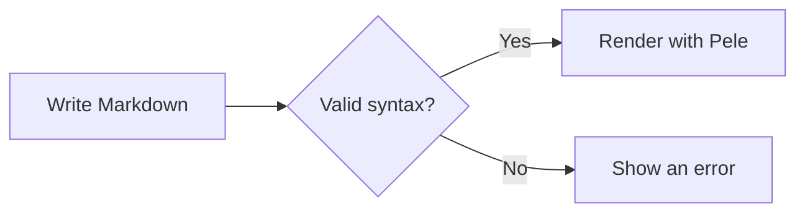
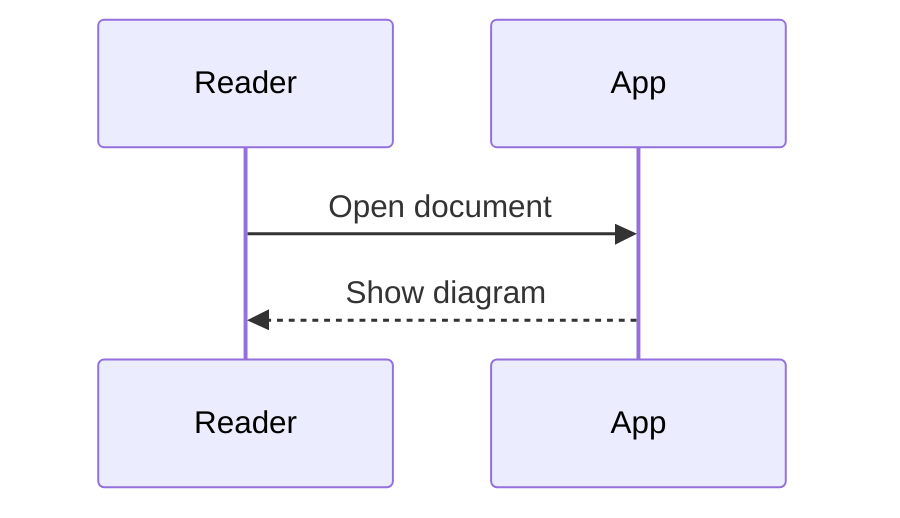
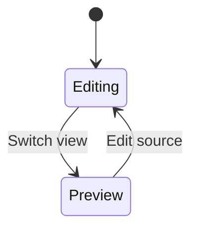
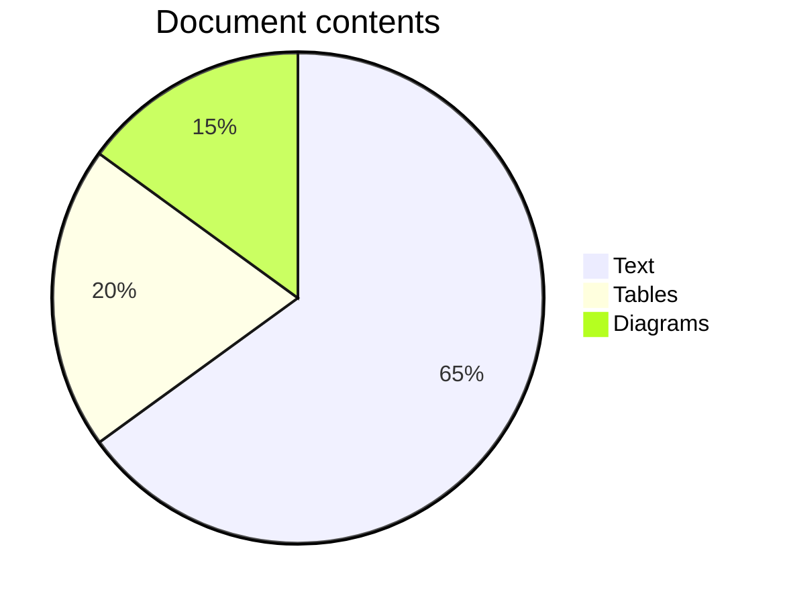

# Mermaid diagrams

Open this file in **Preview** or **Split**. Switch appearance or resize the window to see the diagrams update.

## Flowchart



## Sequence



## State



## Pie chart



## Normal source code stays code

```swift
let message = "Hello, Markdown"
```
